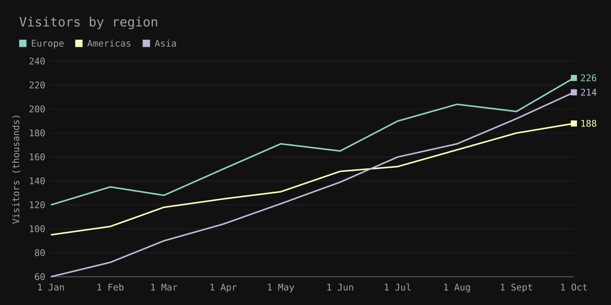

<p align="center">
  
</p>

<h1 align="center">Grapho</h1>

<p align="center">
  <a href="https://grapho.akif.kr"></a>
  <a href="https://www.npmjs.com/package/@ak-tr/grapho"></a>
  <a href="LICENSE"></a>
  
</p>

A graph maker for your own data. Paste or import a table, pick a chart, style it, animate it step by step, and export it as an SVG or PNG still or as an MP4 or GIF.

> [!NOTE]
> Everything runs in your browser. Your data is never uploaded: charts are saved in your browser's local storage, and exports, video included, are made on your machine.

The renderer is also an npm package, [`@ak-tr/grapho`](packages/grapho), so the same charts can be drawn in your own app.



## Features

### Charts from your own data

**Setup** takes CSV, TSV or JSON, imported or pasted. The separator is detected (comma, tab, semicolon, pipe), and numbers, dates and decimal commas are read as you'd expect. JSON can be a list of rows, a list of lists with a header row, or an object of columns, at any depth. Long data (date, name, value) can be split into one series per name.

Six chart types: line, area, scatter, vertical bar, horizontal bar and pie.

### Making it look right

The sidebar has a tab for each part of the chart:

- **Series:** which columns are plotted, each with its colour and a left or right Y axis, and how they're drawn: line shape, smoothing, values on bars or at line ends, bars side by side or overlaid.
- **Axes:** names, ranges and ticks, and how numbers are written (unit, decimals, 2.5k, percent).
- **Labels:** title, key and watermark.
- **Style:** colours (start from a Mosaic colour way or save your own), font and text size, grid lines, size and padding.

Most of it can also be edited by clicking the chart itself, or from the keyboard: Tab into the chart, move between its parts with the arrows and press Enter. Alt+arrows move the key.

### Animation

**Animate** is a list of steps. Each one draws, fades, grows or brings in bars one by one, with its own duration and easing, after or alongside the step before. Drag steps to reorder them. Anything without a step is shown from the start.

### Export

**Export** in the header saves an SVG or PNG of the finished chart, or an MP4 or GIF of the animation at the frame rate you pick. Fonts are embedded, so the files look the same anywhere.

### Saved charts

Every visit starts on a blank chart. Charts with data save as you go, and reopen from **Charts** in the header. **Theme** switches the app between the five Mosaic themes; the chart keeps its own colours.

## Use it in your own app

```sh
npm install @ak-tr/grapho
```

```js
import { draw } from "@ak-tr/grapho";

const chart = draw(document.getElementById("chart"), rows, { type: "line", title: "Sales" });
chart.play();
```

`draw` takes the same data the app does (text, an array of rows or an object of columns), fills in every option you leave out, and draws an SVG as wide as its element. `svg()` returns the SVG as a string without a DOM, for servers. See the [package README](packages/grapho/README.md) for the options.

## Building

Requirements: Node 24 (`.node-version`) and pnpm 9.

```sh
pnpm install
pnpm dev
```

- `pnpm dev`: the app with hot reload on `localhost:4321`.
- `pnpm test`: checks parsing, the timeline, the renderer and the package's API (`src/lib/*.test.ts`).
- `pnpm build`: builds the site into `dist/`.
- `pnpm preview`: builds and serves the site through Wrangler, as Cloudflare will.
- `pnpm build:lib`: builds the package into `packages/grapho/dist/`.

## Deploying

The site is static assets on Cloudflare Workers (`wrangler.jsonc`), served at grapho.akif.kr. Pushing to `main` deploys it. `pnpm run deploy` builds and deploys by hand; `pnpm deploy` without `run` is a different, built-in pnpm command.

## Releasing the package

Bump `version` in `packages/grapho/package.json`, then:

```sh
cd packages/grapho
npm publish
```

`prepublishOnly` builds it first. The package's exports are a public API, so changes to `Config` should stay backwards compatible.

## How it works

`render(table, config, t)` in `src/lib/render.ts` returns the chart at time `t` as an SVG string. The preview, the timeline scrubber, every export and the package all call it, so what you see is what you get. MP4s are encoded in the browser with WebCodecs (via [Mediabunny](https://mediabunny.dev)), GIFs with [gifenc](https://github.com/mattdesl/gifenc).

## Project layout

```
src/pages/          the one page, and the theme applied before paint
src/components/     the app (Svelte 5): header menus, the six sidebar tabs, the chart editor
src/components/ui/  keyboard access and drag-to-reorder, built on UI SDK
src/lib/render.ts   chart → SVG string at time t (no DOM needed)
src/lib/timeline.ts animation steps and easing
src/lib/data.ts     CSV/TSV/JSON parsing and long-data reshaping
src/lib/export.ts   SVG, PNG, MP4 and GIF export (app only)
src/lib/store.ts    saved charts in localStorage (app only)
src/lib/index.ts    the package's public API
packages/grapho/    npm package files; built from src/lib/index.ts
docs/               README images
```

## Credits

- Fonts: [Onest](https://github.com/simpals/onest) and [Geist Mono](https://github.com/vercel/geist-font) (via [Fontsource](https://fontsource.org)), both under the SIL Open Font License 1.1.
- Charts drawn with [d3](https://d3js.org) scales and shapes.
- Visual style based on the [Mosaic](https://github.com/ak-tr/mosaic) design guide.

## License

[MIT](LICENSE). Copyright (c) 2026 akif.
